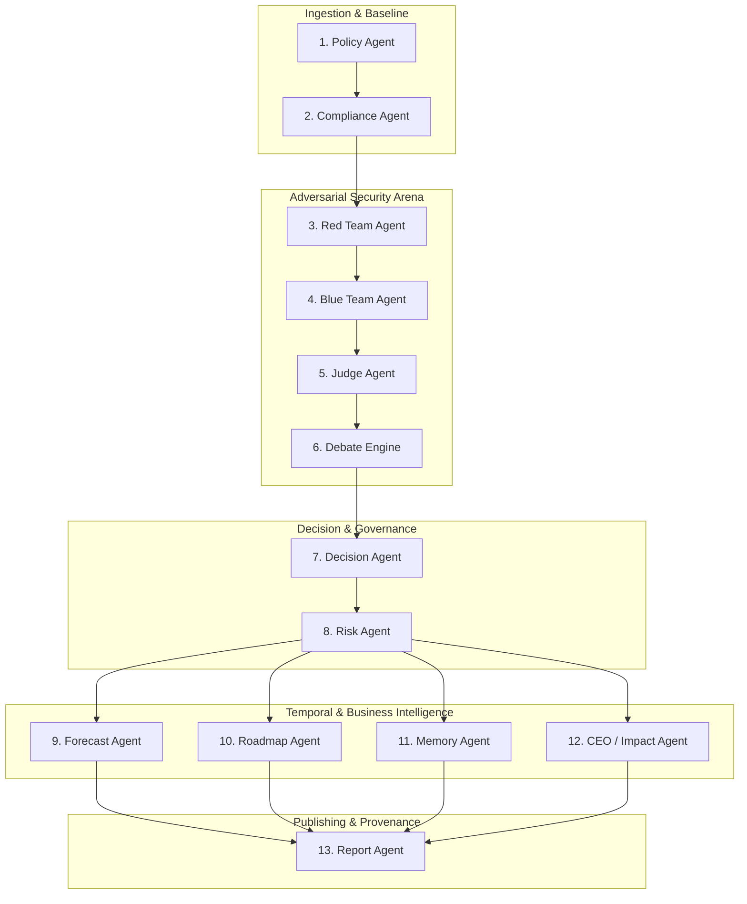

# SentinelAI — 12 Multi-Agent Architecture Specifications & Data Contracts

**Project**: *SentinelAI — Agentic AI-Based Smart Compliance Auditor & AI Security Validation Platform for Enterprise LLM Systems*  
**Batch**: `AIML-B05` · Major Project · 2026–2027  
**Supervisor**: Dr. Mahammad Firose Shaik (`firose786-hub`)  

---

## 1. Multi-Agent Overview

SentinelAI deploys 12 autonomous, specialized agents coordinated sequentially and deliberatively by the `ComplianceOrchestrator`. Every agent operates under a strict data contract defined using Pydantic models.

---

## 2. Detailed Agent Specifications

### 1. Policy & Governance Agent
- **File**: `backend/app/agents/policy_agent.py`
- **Class**: `PolicyAgent`
- **Responsibility**: Ingests organizational charters, scopes applicable regulatory standards, and calculates governance maturity.
- **Input**: `OrganizationProfile`
- **Output**: Dictionary with `policy_coverage_percent`, `governance_maturity`, and `in_scope_standards`.

### 2. Standards Compliance Agent
- **File**: `backend/app/agents/compliance_agent.py`
- **Class**: `ComplianceAgent`
- **Responsibility**: Conducts control-by-control assessment against ISO/IEC 27001:2022 and NIST CSF 2.0.
- **Input**: `OrganizationProfile`
- **Output**: `Tuple[List[ControlAssessment], int, int, int]` (Assessments, ISO Score, NIST Score, Overall Score).

### 3. Adversarial Red Team Agent
- **File**: `backend/app/agents/red_team_agent.py`
- **Class**: `RedTeamAgent`
- **Responsibility**: Simulates adversarial attacks across the OWASP Top 10 for LLMs (2025). Evaluates defenses based on active controls.
- **Input**: `OrganizationProfile`
- **Output**: `List[Dict[str, Any]]` of raw exploit observations.

### 4. Defensive Blue Team Agent
- **File**: `backend/app/agents/blue_team_agent.py`
- **Class**: `BlueTeamAgent`
- **Responsibility**: Analyzes mitigating controls, compensating mechanisms (SPEP patterns), and contextual defenses to minimize false positives.
- **Input**: `OrganizationProfile`, `List[Dict[str, Any]]` (raw attacks)
- **Output**: `List[Dict[str, Any]]` of defensive posture evaluations and suggested remediations.

### 5. Impartial Security Judge Agent
- **File**: `backend/app/agents/judge_agent.py`
- **Class**: `JudgeAgent`
- **Responsibility**: Cross-examines Red vs Blue findings, issues formal legal/technical verdicts, maps to CWEs, and calculates the AI Security Score.
- **Input**: Defensive findings from Blue Team
- **Output**: `Tuple[List[AISecurityFinding], int]` (Finalized findings, AI Security Score 0–100).

### 6. AI Debate Engine
- **File**: `backend/app/agents/debate_engine.py`
- **Class**: `AIDebateEngine`
- **Responsibility**: Conducts multi-turn adversarial deliberation between Skeptic (Red) and Advocate (Blue) under the Judge to reach un-hallucinated consensus.
- **Input**: `OrganizationProfile`, Scores, Controls, Findings
- **Output**: `AIDebateResult` (Round transcripts, rulings, confidence score).

### 7. Final Decision Agent
- **File**: `backend/app/agents/decision_agent.py`
- **Class**: `DecisionAgent`
- **Responsibility**: Synthesizes multi-agent deliberations into the final statutory audit verdict (`APPROVED`, `APPROVED WITH REMEDIATION`, `HIGH RISK`, `CRITICAL RISK`).
- **Input**: Compliance score, AI security score, Risk score, Critical vulnerability count
- **Output**: `Tuple[AuditVerdict, str, SeverityLevel]` (Verdict, Rationale, Tier).

### 8. Quantitative Risk Agent
- **File**: `backend/app/agents/risk_agent.py`
- **Class**: `RiskAgent`
- **Responsibility**: Quantifies composite risk score (0–100) using multi-factor penalty weighting.
- **Input**: Scores, finding counts, critical severity counts
- **Output**: `Tuple[int, SeverityLevel, str]` (Risk score, Tier, Narrative).

### 9. Compliance Forecast Agent
- **File**: `backend/app/agents/forecast_agent.py`
- **Class**: `ForecastAgent`
- **Responsibility**: Projects 30, 60, and 90-day trajectory scores based on milestone fix completion velocities.
- **Input**: Current overall score, Roadmap items, Findings
- **Output**: `ComplianceForecast` with 3 predictive milestone trajectories.

### 10. Actionable Roadmap Agent
- **File**: `backend/app/agents/roadmap_agent.py`
- **Class**: `RoadmapAgent`
- **Responsibility**: Translates audit gaps and vulnerabilities into an actionable P1/P2/P3 remediation plan with responsible teams and target days.
- **Input**: Controls assessment, AI findings
- **Output**: `List[RoadmapItem]`.

### 11. Longitudinal Memory Agent
- **File**: `backend/app/agents/memory_agent.py`
- **Class**: `MemoryAgent`
- **Responsibility**: Queries historical SQLite audits to detect recurring, persistent, or escalating vulnerabilities over time.
- **Input**: Organization ID, Current scores, Current findings
- **Output**: `MemoryComparison` with score deltas and recurring issue tracking.

### 12. CEO & Business Impact Agent
- **File**: `backend/app/agents/ceo_agent.py`
- **Class**: `CEOAgent`
- **Responsibility**: Converts complex security metrics into plain-English executive summaries, estimated downtime hours, and quantitative monetary loss models ($5M–$12M).
- **Input**: `OrganizationProfile`, Scores, Verdict, Findings
- **Output**: `Tuple[BusinessImpact, CEOSummary]`.

### 13. Publication Report Agent
- **File**: `backend/app/agents/report_agent.py`
- **Class**: `ReportAgent`
- **Responsibility**: Synthesizes the entire multi-agent audit dataset into publication-grade ReportLab PDF, Markdown, and JSON formats.
- **Input**: `AuditRecord`
- **Output**: Formatted bytes/strings for instant download.
