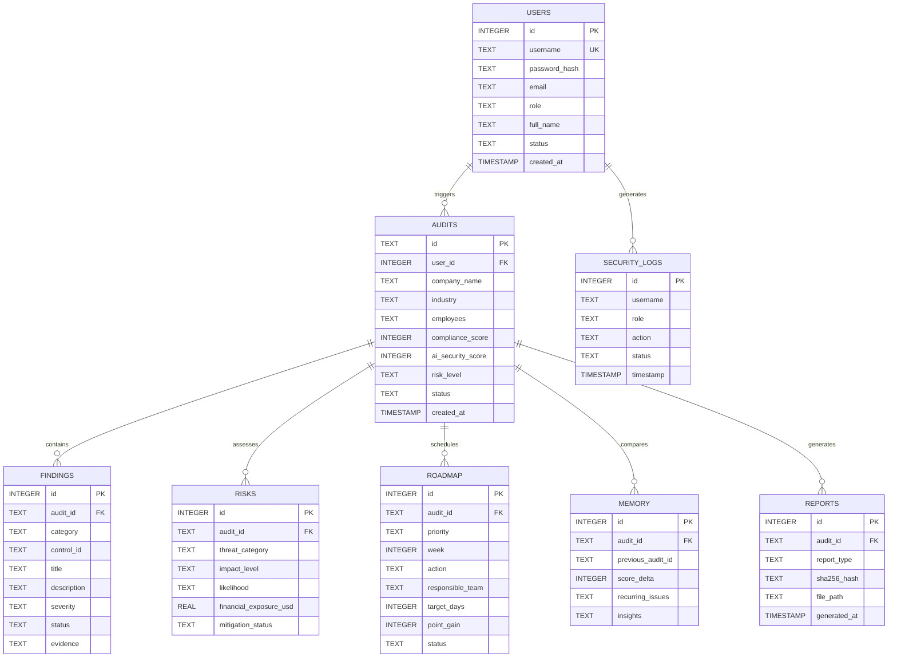

# SentinelAI — Relational Database Architecture & Schema Documentation

**Database Engine**: SQLite 3  
**Database File**: `backend/data/analyses.db`  
**Schema Implementation**: `backend/app/database.py`  
**Security Standard**: Non-repudiation audit trails with SHA-256 hashed passwords and cryptographic verification.  

---

## 1. Entity-Relationship Model (7 Core Relational Tables)

---

## 2. Table Schemas & Field Definitions

### 1. `users`
Manages system accounts, RBAC entitlements, and hashed authentication secrets:
- `id` (INTEGER, PK, AUTOINCREMENT)
- `username` (TEXT, UNIQUE, NOT NULL)
- `password_hash` (TEXT, NOT NULL) — SHA-256 hex digest
- `email` (TEXT)
- `role` (TEXT, DEFAULT 'Compliance Officer')
- `full_name` (TEXT)
- `status` (TEXT, DEFAULT 'Active')
- `created_at` (TIMESTAMP, DEFAULT CURRENT_TIMESTAMP)

### 2. `audits`
Stores enterprise compliance and security audit execution records:
- `id` (TEXT, PK) — Unique identifier (e.g. `AUDIT-9F4B2A81`)
- `user_id` (INTEGER, FK to `users.id`)
- `company_name` (TEXT)
- `industry` (TEXT)
- `employees` (TEXT)
- `compliance_score` (INTEGER, 0–100)
- `ai_security_score` (INTEGER, 0–100)
- `risk_level` (TEXT)
- `status` (TEXT) — Verdict string
- `created_at` (TIMESTAMP, DEFAULT CURRENT_TIMESTAMP)

### 3. `findings`
Detailed ISO/NIST control gaps and OWASP LLM attack outcomes:
- `id` (INTEGER, PK, AUTOINCREMENT)
- `audit_id` (TEXT, FK to `audits.id`)
- `category` (TEXT) — Standard name (e.g., "ISO/IEC 27001:2022")
- `control_id` (TEXT) — Control identifier (e.g., "A.8.7", "LLM01")
- `title` (TEXT)
- `description` (TEXT)
- `severity` (TEXT) — `Critical`, `High`, `Medium`, `Low`
- `status` (TEXT) — `Compliant`, `Vulnerable`, `Protected`
- `evidence` (TEXT) — Detailed empirical evidence trail

### 4. `risks`
Quantified financial and operational risk estimates:
- `id` (INTEGER, PK)
- `audit_id` (TEXT, FK)
- `financial_exposure_usd` (REAL) — Monetary exposure value

### 5. `roadmap`
Actionable remediation milestones:
- `id` (INTEGER, PK)
- `audit_id` (TEXT, FK)
- `priority` (TEXT) — `P1`, `P2`, `P3`
- `action` (TEXT) — Prescribed mitigation step
- `responsible_team` (TEXT) — Team owner
- `target_days` (INTEGER) — Remediation SLA

### 6. `memory`
Longitudinal audit history tracking:
- `audit_id` (TEXT, FK)
- `previous_audit_id` (TEXT)
- `score_delta` (INTEGER) — Difference from previous audit
- `recurring_issues` (TEXT) — JSON array of persistent findings

### 7. `security_logs`
Tamper-evident SIEM security event log:
- `id` (INTEGER, PK)
- `username` (TEXT)
- `role` (TEXT)
- `action` (TEXT) — Sign-In, Role Change, Scan Triggered
- `status` (TEXT) — `SUCCESS` or `FAILURE`
- `timestamp` (TIMESTAMP, DEFAULT CURRENT_TIMESTAMP)

---

## 3. Pre-Seeded Enterprise Accounts

All accounts are pre-seeded in `backend/app/database.py` with standard demo credentials and universal hardware MFA token `749201`:

| Username | Default Password | Enterprise Persona / Full Name | RBAC Role |
| :--- | :--- | :--- | :--- |
| `admin` | `admin` | Dr. Alexander Cross (Global Security Director) | **Super Admin** |
| `ciso` | `ciso` | Victoria Vance (Chief Information Security Officer) | **CISO Executive** |
| `compliance`| `compliance` | Marcus Sterling (Lead Regulatory Counsel) | **Compliance Officer** |
| `ai_engineer`| `engineer` | Elena Rostova (Principal AI Safety Architect) | **AI Security Engineer**|
| `soc_analyst`| `analyst` | David Kim (Senior Incident Responder) | **SOC Analyst** |
| `auditor` | `auditor` | Sarah Jenkins (Independent GRC Lead Assessor) | **External Auditor** |
