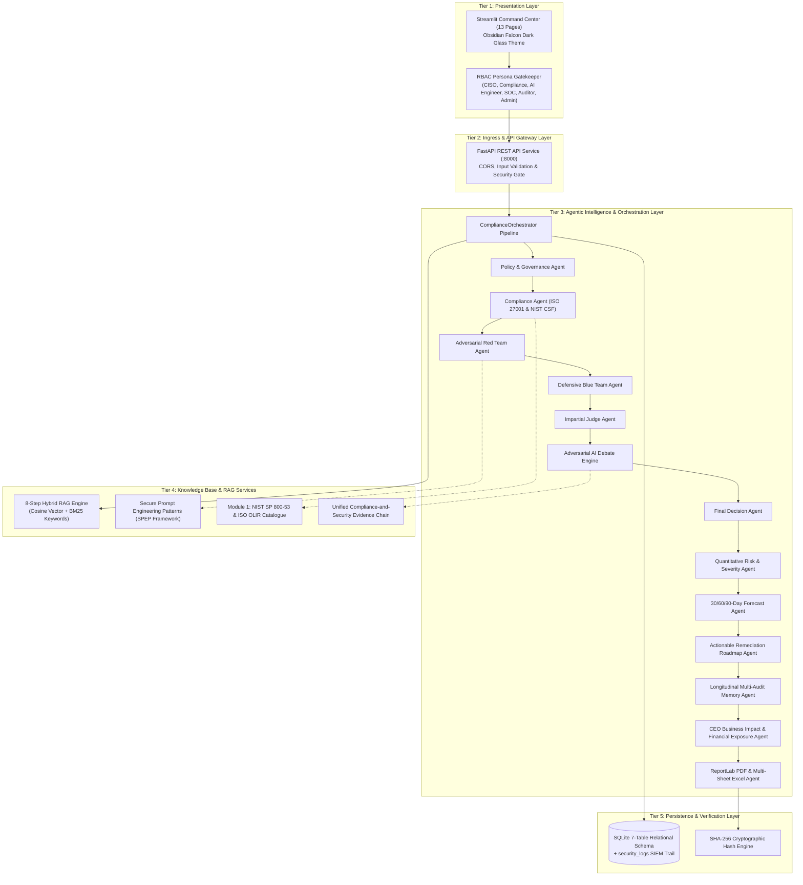
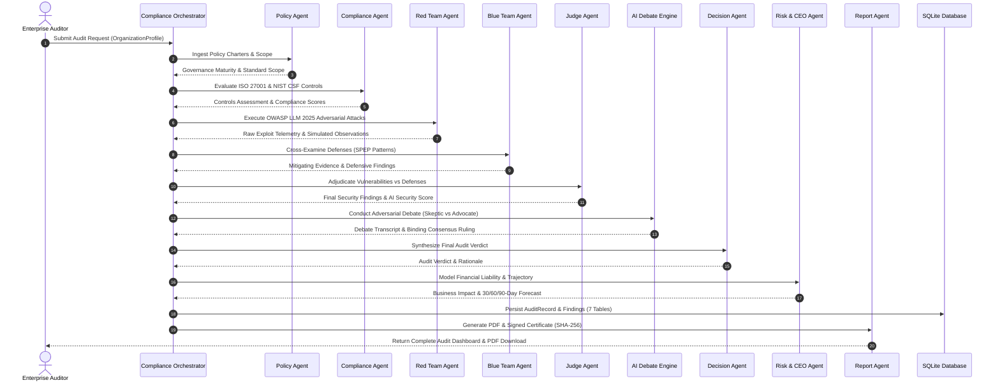

# SentinelAI — System Architecture & Multi-Agent Design Document

**Project**: *SentinelAI — Agentic AI-Based Smart Compliance Auditor & AI Security Validation Platform for Enterprise LLM Systems*  
**Architecture Version**: v3.0 Enterprise SOC  
**Batch**: `AIML-B05` · Major Project · 2026–2027  
**Supervisor**: Dr. Mahammad Firose Shaik (`firose786-hub`)  

---

## 1. High-Level Architectural Topology

SentinelAI follows an Enterprise Hybrid Layered Architecture composed of 5 distinct tiers:

---

## 2. Multi-Agent Collaboration Workflow

---

## 3. Core Architectural Subsystems

### 3.1 Dual-Runtime Operational Architecture
To ensure high availability in restricted defense, banking, or air-gapped enterprise environments:
1. **Google Gemini LLM Cloud Mode**: When `GEMINI_API_KEY` is present, agents dynamically use `gemini-2.5-flash` for multi-turn adversarial reasoning, natural language summary synthesis, and compliance gap interpretations.
2. **Deterministic Offline Fallback Mode**: When the API key is not configured, the system operates completely offline using AST syntactic analysis, regex token matching, cosine similarity trigger scoring, and grounded SQLite rule matrices. Zero degradation in audit completeness occurs.

### 3.2 Unified Evidence Chain Architecture (Innovation 1)
Connects disparate security scanner findings into regulatory governance failures:
- Exploit detected in **OWASP LLM01 (Prompt Injection)**
- Automatically degrades **NIST SI-10 (Information Input Validation)**
- Automatically degrades **ISO/IEC 27001:2022 Control A.8.28 (Secure Coding)**
- Subtracts calculated penalty points from overall compliance score.
- Propagates directly into CISO financial exposure calculation.

### 3.3 Cryptographic Integrity Verification Subsystem
Every finalized compliance audit record generates a canonical payload string:
`audit_id:org_name:compliance_score:verdict:timestamp:SENTINEL_AI_CLEARANCE`
This payload is hashed using **SHA-256** and embedded into:
- The PDF Certificate of Clearance (with QR verification block).
- The Excel audit workbook metadata.
- The SQLite `audits` database table for non-repudiation and external auditor verification.
