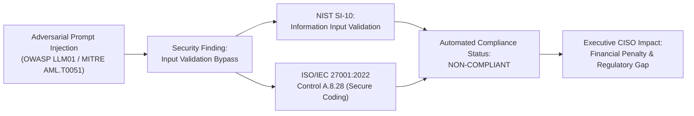

# Module 1 (M1): Control Catalogue & AI Threat Taxonomy

**Project**: *SentinelAI — Agentic AI-Based Smart Compliance Auditor & AI Security Validation Platform for Enterprise LLM Systems*  
**Batch**: `AIML-B05` · Major Project · 2026–2027  
**Supervisor / Guide**: Dr. Mahammad Firose Shaik (`firose786-hub`)  
**Target GitHub Repository**: `https://github.com/firose786-hub/SentinelAI`  

---

## 🎯 Executive Overview

Module 1 (M1) establishes the foundational cyber-governance and AI threat ontology for the entire SentinelAI platform. Before autonomous AI agents can audit code or simulate adversarial red-teaming attacks, the platform requires an authoritative, machine-readable repository of international security controls, vulnerability taxonomies, and crosswalk relationships.

This module delivers:
1. **Machine-Readable Control Catalogue** (`controls.json`, `controls.csv`): Grounded in **NIST SP 800-53 Rev. 5** and **NIST Cybersecurity Framework (CSF) 2.0** across key control families (`AC`, `IA`, `SI`, `SC`, `AU`, `IR`) tailored explicitly for Generative AI/LLM workloads.
2. **Official NIST OLIR Crosswalk** (`iso_nist_mapping.csv`): Strict cross-referencing between NIST controls and **ISO/IEC 27001:2022 Annex A** controls without fictitious clauses.
3. **AI Threat Taxonomy** (`threats.json`): Comprehensive classification synthesizing **OWASP Top 10 for LLM Applications (2025)**, **MITRE ATLAS (Adversarial Threat Landscape for AI Systems)**, and **NIST AI 600-1**.
4. **Unified Compliance & Security Evidence Chain** (`threat_control_mapping.json`): Groundbreaking many-to-many bidirectional mapping demonstrating how an AI security exploit cascades directly into regulatory non-compliance.
5. **Self-Assessment Questionnaire** (`questionnaire.json`): Weighted enterprise audit questionnaire with required evidentiary artifacts.
6. **Automated Crosswalk Validator** (`validator.py`, `run_validator.bat`): Referential integrity engine that verifies zero dangling references and calculates catalogue coverage metrics.

---

## 📁 Module 1 File Structure

```text
modules/m1_control_catalogue/
├── controls.json               # 14 Detailed NIST SP 800-53 Rev. 5 controls with LLM guidance
├── controls.csv                # Tabular spreadsheet version of NIST controls
├── iso_nist_mapping.csv        # Official NIST OLIR crosswalk to ISO/IEC 27001:2022 Annex A
├── threats.json                # Complete OWASP LLM 2025 + MITRE ATLAS threat taxonomy
├── threat_control_mapping.json # Innovation 1: Unified Evidence Chain connecting threats to controls
├── questionnaire.json          # Machine-scorable enterprise self-assessment questionnaire
├── validator.py                # Python schema integrity and referential cross-checker
├── run_validator.bat           # 1-Click double-clickable Windows validation batch script
└── README.md                   # This comprehensive module documentation
```

---

## 🔬 Official Standards & Reference Frameworks

| Standard / Framework | Issuing Authority | Scope & Relevance in SentinelAI |
| :--- | :--- | :--- |
| **NIST SP 800-53 Rev. 5** | National Institute of Standards & Technology | Security and Privacy Controls for Information Systems and Organizations. Focuses on AC, IA, SI, SC, AU, IR. |
| **NIST CSF 2.0** | National Institute of Standards & Technology | High-level cybersecurity lifecycle functions: *Govern, Identify, Protect, Detect, Respond, Recover*. |
| **NIST OLIR** | National Institute of Standards & Technology | Online Informative References program providing formal mappings between NIST and ISO standards. |
| **ISO/IEC 27001:2022** | International Organization for Standardization | Annex A organizational, people, physical, and technological information security controls. |
| **OWASP LLM Top 10 (2025)**| Open Web Application Security Project | De-facto industry benchmark for Generative AI risks (LLM01 Prompt Injection through LLM10 Unbounded Consumption). |
| **MITRE ATLAS** | MITRE Corporation | Adversarial Threat Landscape for AI Systems (e.g., AML.T0051 Prompt Injection, AML.T0054 Jailbreak). |
| **NIST AI 600-1** | National Institute of Standards & Technology | Artificial Intelligence Risk Management Framework (AI RMF) Generative AI Profile. |

---

## 💡 Innovation Grounding: Unified Evidence Chain

In traditional enterprises, security scanners (e.g., vulnerability scanners) and compliance auditors (e.g., GRC spreadsheets) work in silos. 

**SentinelAI's Innovation 1** directly integrates them:


When Red Team agents simulate a prompt injection exploit, the platform automatically flags `NIST SI-10` and `ISO A.8.28` as compromised, providing undeniable proof and cryptographic hash verification for auditors.

---

## ⚡ How to Run and Verify M1

### Option 1: 1-Click Double Click
In Windows File Explorer, simply double-click:
`run_validator.bat`

### Option 2: Terminal Execution
```bash
cd modules/m1_control_catalogue
python validator.py
```

### Expected Output:
```text
===========================================================================
       SENTINELAI: MODULE 1 (M1) INTEGRITY & CROSSWALK VALIDATOR
===========================================================================
✔ [Controls JSON] Loaded 14 controls across 5 families.
✔ [Controls CSV] Exact row count parity confirmed (14 rows).
✔ [Threats JSON] Loaded 10 AI Threats (OWASP LLM Top 10 2025 / MITRE ATLAS).
✔ [Evidence Chain Mapping] 10/10 threats mapped to primary controls.
✔ [NIST OLIR Crosswalk] Loaded 24 ISO/IEC 27001:2022 crosswalk relationships.
✔ [Self-Assessment Questionnaire] 13 audit questions (Max Score: 135).
✔ [Catalogue Coverage] 100.0% of catalogued control families covered in questionnaire.

===========================================================================
                           VALIDATION SUMMARY
===========================================================================
🏆 100% VALIDATION PASSED! Zero errors and zero warnings found.
   Module 1 (M1) is verified, consistent, and ready for viva demonstration.
===========================================================================
```

---

## 🎓 Viva Questions & Model Answers for Module 1

**Q1: Why did you start with Module 1 instead of jumping straight into AI agent coding?**  
*Model Answer*: "In academic software engineering and enterprise cybersecurity, building autonomous AI agents without a structured ontology leads to hallucinations and non-standardized audit results. Module 1 establishes the deterministic ground-truth catalogue: official NIST SP 800-53 Rev. 5 controls, NIST OLIR ISO 27001 mappings, and OWASP LLM 2025 threat vectors. Our agents (Policy Agent, Compliance Agent, Red/Blue Team) query this exact catalogue during audit deliberation."

**Q2: What is the NIST OLIR crosswalk and why is it important in your project?**  
*Model Answer*: "NIST OLIR stands for Online Informative References. Rather than subjectively inventing arbitrary relationships between NIST and ISO 27001, OLIR provides officially validated, peer-reviewed crosswalk mappings with clear mathematical relationships (Equivalent, Subset-of, Intersects). This ensures that our compliance scoring is academically defensible and enterprise-grade."

**Q3: How does your Threat Taxonomy bridge classic cybersecurity with Generative AI?**  
*Model Answer*: "Classic standards like ISO 27001 and NIST SP 800-53 were written for traditional web apps and cloud systems. Generative AI introduces non-deterministic attack vectors such as Prompt Injection (OWASP LLM01) and System Prompt Leakage (OWASP LLM07). Module 1 creates an explicit bridge: we mapped each AI-specific threat directly to underlying fundamental controls like Input Validation (SI-10), Boundary Protection (SC-7), and Least Privilege (AC-6)."

---

## 👥 Batch AIML-B05 Team Contributions

- **Pattem Dolly Sai Iswarya (23BQ1A61A4)**: NIST SP 800-53 Rev. 5 Control Family Cataloguing & ISO 27001 OLIR Crosswalk Analysis.
- **Palamarthi Shiva Sai Devi Apoorva (23BQ1A6196)**: OWASP Top 10 for LLM Applications 2025 & MITRE ATLAS Threat Taxonomy.
- **Palagani Hari Siva Prasad (24BQ5A6112)**: Unified Evidence Chain Mapping Schema & Referential Integrity Validator Engine.
- **Mallavarapu Pradeep Chandra (23BQ1A6174)**: Enterprise Audit Questionnaire Development, Weight Scoring Logic & Documentation.
